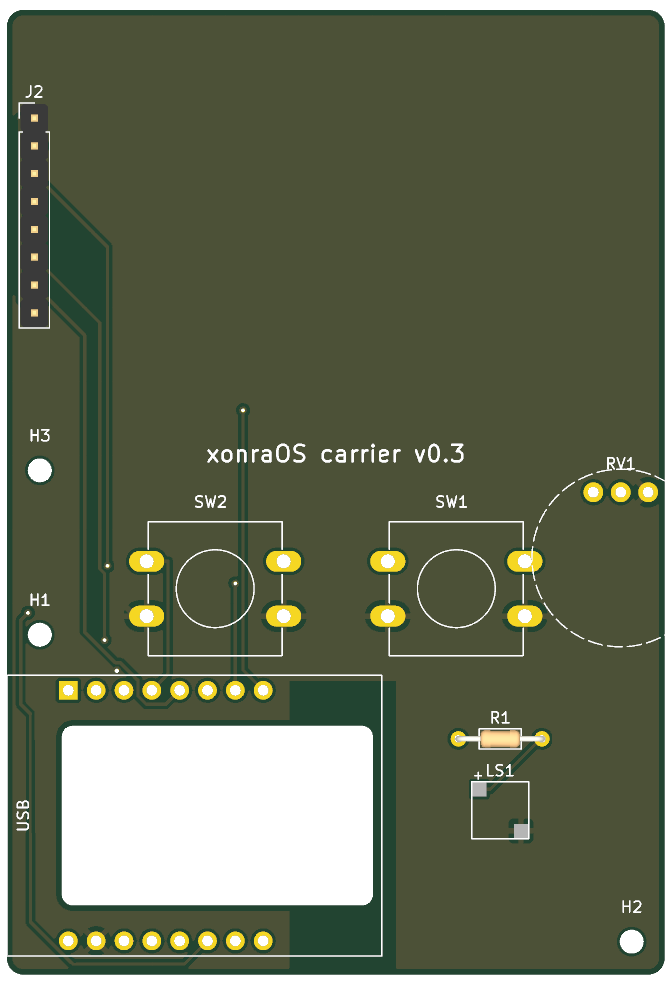

# xonraOS carrier board v0.3 (the low-cost version)

A 2-layer, 60 × 88 mm board with the same outline, screen, buttons and side wheel as the v0.2 board, so it fits the
printed case in `../case`. The difference: instead of a factory-assembled ESP8266 + USB circuit, a ready-made
**Wemos D1 mini** is soldered flat onto it. Every part is through-hole or has big pads, so you can **order the bare
board (no assembly fee) and solder it yourself**.

Checked with KiCad's design-rule check: **0 unconnected pins, 0 errors** (only cosmetic silkscreen warnings).

> **Status: not built yet.** Measure your D1 mini before ordering (see "Check before ordering").

## Cost (rough, November 2026)

| Item | Where | Approx. |
|---|---|---|
| Carrier PCB, 5 pcs (`production/xonraOS-gerbers.zip`) | JLCPCB, no assembly | $2–4 |
| Wemos D1 mini (ESP8266, CH340) | AliExpress | about 8 SAR |
| 1.8" ST7735 TFT 128×160, SPI, 8-pin | AliExpress | about 12–15 SAR |
| 2 × 12 × 12 × 4.3 mm tactile buttons, 5 × 5 mm buzzer, 220 Ω resistor | AliExpress | about 5 SAR |
| Flat 16 mm thumbwheel potentiometer 10k | AliExpress | about 3–5 SAR |
| Case (`../case`) | JLC3DP, same order as the PCB | about 40 SAR |

Shipping is the biggest unknown: order the PCB and the case together, and all the small parts in one AliExpress order.

## Order the board

JLCPCB → "Add gerber file" → `production/xonraOS-gerbers.zip`. 2 layers, 1.6 mm, any colour. **Leave "PCB Assembly" off.**

## Solder it

1. **D1 mini:** push its male pin header through the D1 mini and the carrier, then **slide the black plastic spacer
   off** so the D1 mini lies flat (the parts under it drop into the cutout). USB to the left board edge. Solder both sides, trim.
2. **Screen (J2):** pin 1 at the top = VCC, then GND, CS, RESET, A0/DC, SDA, SCK, LED.
3. **Buttons** SW1 (main, D3) and SW2 (second, D6), **R1** 220 Ω, **buzzer LS1** (+ pad marked), **wheel RV1**.
4. Trim all solder legs on the back to about 1.5 mm so the board sits on the case posts.
5. Flash `firmware/xonraOS_TFT` as usual over the D1 mini's USB. No firmware changes are needed.

## Circuit

| D1 mini pin | Goes to |
|---|---|
| D5, D7 | TFT SCK, SDA (MOSI) |
| D1, D2 | TFT CS, A0/DC |
| RST | TFT RESET |
| D3 | main button to GND |
| D6 | second button to GND |
| D8 | 220 Ω, then buzzer to GND |
| A0 | wheel wiper (wheel ends on 3V3 and GND) |
| 3V3, G | TFT VCC and LED, wheel, ground pour |

## Check before ordering

- **D1 mini pin position:** the footprint assumes the 3V3/5V pins sit 5.6 mm from the USB end (typical). Measure yours.
- **Parts under the D1 mini** must fit inside the cutout (16.4 mm wide).
- **TFT pin order** as above (common red module). If yours differs, change the J2 pads in `make_board.py`.
- **Buzzer and wheel footprints** are generic (`../pcb/xonraOS.pretty`): compare with the parts you buy.

## Rebuild

From Git Bash: `sh build.sh` (KiCad 10, Freerouting 2.5 + Java 25), then
`"<KiCad>\bin\python.exe" export_jlc.py`. The script `make_board.py` holds all parts and nets.

License: CERN-OHL-S-2.0
