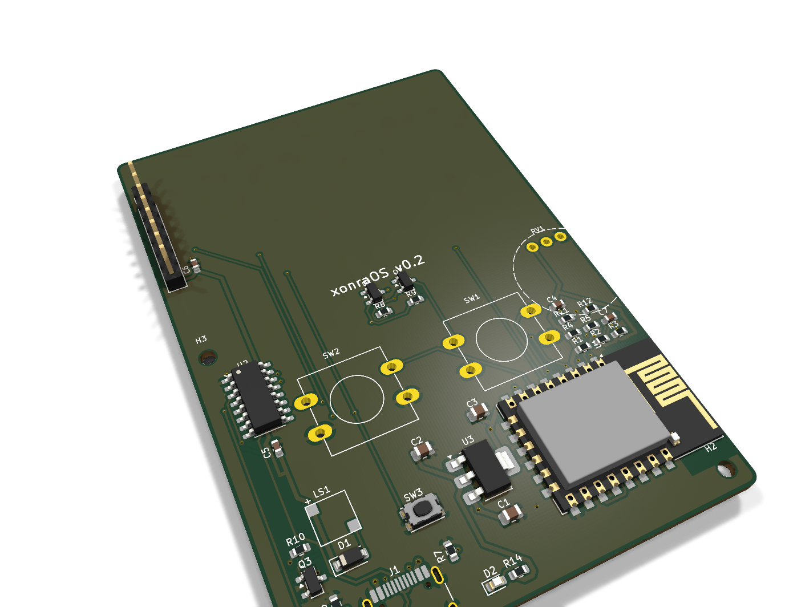

# xonraOS board v0.2 — KiCad PCB (1.8" colour TFT, portrait)



A 2-layer, 60 × 88 mm board that runs the TFT firmware (`firmware/xonraOS_TFT`) and fits the printed case in `../case`.
It was generated by scripts, routed with Freerouting, and checked with KiCad's design-rule check:
**0 unconnected pins, 0 electrical errors** (only cosmetic silkscreen warnings; see `drc-report.json`).

> **Status: not built yet.** The first boards may need small fixes. Before ordering, ask someone experienced to
> look at it (for example r/PrintedCircuitBoard), and check the parts below.

## Order it (JLCPCB)

Everything is in `production/`:

| File | Upload where |
|---|---|
| `xonraOS-gerbers.zip` | "Add gerber file". 2 layers, 1.6 mm, any colour (black looks premium). |
| `bom.csv` | "PCB Assembly" → BOM. Parts marked "by hand" are not assembled by JLCPCB. |
| `cpl.csv` | "PCB Assembly" → CPL (placement). |

In the assembly preview, **check the rotation of each part** (especially U1, U2, U3, the transistors and J1)
and rotate any that look wrong: the factory's part models do not always match KiCad's.

Solder these yourself afterwards (then trim all solder legs to about 1.5 mm so the board fits the thin case): the 1.8" TFT module (on J2, 8-pin header), the two low-profile 12 × 12 × 4.3 mm buttons (SW1, SW2),
the 5 × 5 mm buzzer (LS1) and the flat 16 mm thumbwheel potentiometer (RV1).

## What to check before ordering

- **TFT pin order (J2):** pin 1 at the top = VCC, then GND, CS, RESET, A0/DC, SDA, SCK, LED. This is the order on the
  common red 1.8" module; if yours differs, change the J2 pads in `make_board.py` and rebuild.
- **Buzzer (LS1) and thumbwheel (RV1)** use generic footprints in `xonraOS.pretty`: compare them with the datasheet of
  the parts you buy (pad positions, pin order: RV1 pin 1 = 3V3, 2 = wiper, 3 = GND).
- **LCSC part numbers** in `make_board.py` were picked from memory: confirm each is in stock at JLCPCB.

## Circuit summary

Pins match the TFT firmware: TFT SCK GPIO14, MOSI GPIO13, CS GPIO5, DC GPIO4, RESET = board reset; main button GPIO0
(also the flash button), second button GPIO12, buzzer GPIO15 through an S8050 transistor, thumbwheel on the ADC through a
220k/100k divider. USB-C → CH340C (powered at 3.3 V) with automatic reset/flash (two S8050s on DTR/RTS) → no buttons
needed to upload. AMS1117-3.3 regulator. The full net list is the `NETS` table in `make_board.py`.

## Rebuild it

Needs KiCad 10 and Java 25 + [Freerouting](https://github.com/freerouting/freerouting) 2.5.

```
"<KiCad>\bin\python.exe" make_board.py        # place parts, nets, outline, pours, keep-outs
"<KiCad>\bin\python.exe" route.py <java.exe> <freerouting.jar> 150
"<KiCad>\bin\kicad-cli.exe" pcb drc --refill-zones --save-board xonraOS.kicad_pcb
"<KiCad>\bin\python.exe" export_jlc.py        # production/ files
```

Part positions in `make_board.py` must stay in step with `../case/xonra-board-case.js` (buttons, wheel, USB-C, screen).

License: CERN-OHL-S-2.0 (see `../LICENSE`).
